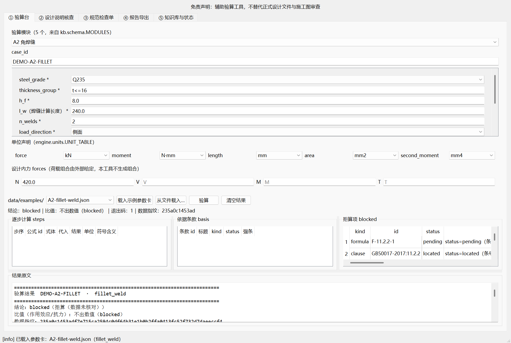

# steel-design-checker — 钢结构连接与构件验算的离线桌面工具，逐条挂 GB 条款号

[](https://github.com/yuluo554/steel-design-checker/actions/workflows/ci.yml)
[](https://github.com/yuluo554/steel-design-checker)
[](LICENSE)



**给结构设计**：5 个连接与稳定验算模块 + 设计说明文本核查（10 条规则）+ GB 55006-2021 符合性
检查单（全 8 章 107 条）+ 内置基准 + docx 交付物。每条结论挂「标准号 + 条号」，全离线、零第三方依赖。

**它不是**：自动出图、荷载组合生成、节点构造优化，也不替代正式设计文件与施工图审查。
这句免责声明强制写进每一条计算结果、每份导出的 docx，以及终端输出的最后一行。

## 给谁用

- 结构设计人员：连接（对接焊缝 / 角焊缝 / 普通螺栓 / 高强螺栓摩擦型）与轴心受压稳定验算，
  输出应力比、结论与**逐条依据条款号 + 公式编号**。
- 审图与校核：把设计说明参数抽成参数卡，按 10 条规则做「异常 / 可疑 / 通过」三级文本核查。
- 合规自查：按 GB 55006-2021 检查单逐项过，9 条挂自动初判、其余显式「待人工确认」。

## 30 秒跑起来

```bash
# 方式 A（免安装）：Releases 里下 sdc-gui 与 sdc-cli 两个 zip，一起解压 → 双击 sdc-gui.exe
#   两个包要一起放（页签②解析与一键基准用同侧 sdc-cli.exe 当子进程），理由见 DEVELOPMENT.md
# 方式 B（源码）：运行只需 Python 3.8+ 标准库，不装任何包
git clone https://github.com/yuluo554/steel-design-checker.git
cd steel-design-checker
set PYTHONPATH=src                        # PowerShell 用 $env:PYTHONPATH="src"；Git Bash 用 export PYTHONPATH=src
py -3.8 -X utf8 -m sdc selfcheck          # 数据完整性 + 三档 status 看板 + 模块门控
py -3.8 -X utf8 -m sdc run --module fillet_weld --case data/examples/A2-fillet-weld.json
```

预期：`selfcheck` 打印三档看板（clause 161 / table 13 / formula 14 / rule 10 / checklist 107）
与 5 个模块的门控；`run` 输出 `结论：blocked（拒算（数据未核对））` 并逐项说明缺哪条核对。

退出码：`0` 完成 / `1` 降级完成（拒算、有可疑项、指标未达标）/ `2` 输入不可用。

`sdc bench` 另有一个可选粒度：**`--allow-indeterminate`** 只把「不可判」（分母 0，这条现在
量不了）从 `1` 里摘出来，`0.1.1` 起 CI 就带这一条；**「未达标」与「不可用」照旧红**，
指标表里那几行仍逐项写「不可判」，不会被渲染成达标。不带旗标时行为与 0.1.0 相同（仍 `1`）。

## 它解决什么问题

规范验算的难点不是套公式，而是**公式与表值的来源可追溯**：一旦强度设计值或 φ 曲线来源不明，
算出来的数值比没有数值更危险。本工具把「条款库」按三档 `status` 管理 —— **只有 `verified` 能进
计算路径**；`located`（条号与主题已定位、数值未核对）与 `pending` 一样让模块 `blocked`，
而且 blocked 结果里**一个数值都没有**，只有逐项缺什么。

数值通路的正确性靠 `tests/fixtures/kb/` 的**合成 verified 夹具**验证（虚构数据、渠道标注"合成夹具"）：
同一套引擎、同一套门控，夹具上出逐步计算，真实数据上拒算。夹具数值不许复制进 `data/`（有测试守着）。

## 指标（本机实测）

下表由 `sdc bench --all --markdown` 生成，`tests/test_suite.py` 逐行与实测对账 —— 改了数据没重跑，
这条测试会红。**「不可判」是诚实的分母 0，不是通过。**

| 指标 | 门槛 | 实测 | 结论 | 来源命令 |
|---|---|---|---|---|
| 算例通过率 | 100% | 分母 0，样本待补 | 不可判 | `sdc bench --cases` |
| 确定性回归 | 100%，违反即未达标 | 24 份 IR 两次一致 | 达标 | `sdc bench --sweep` |
| 解析 F1 | ≥ 0.95 | 1.0000 | 达标 | `sdc bench --parse` |
| 缺陷检出率 | ≥ 0.95 | 1.0000 | 达标 | `sdc bench --audit` |
| 误报 | 0（硬门） | 0 处 | 达标 | `sdc bench --audit` |
| 条款可溯源率 | 100% | 12 / 12 条 finding 带条款 | 达标 | `sdc selfcheck` |
| 待核对闸门 | 0 例（必须 blocked） | 0 例漏出数值 | 达标 | `sdc run / sdc selfcheck` |
| 0 外链 | 0（硬门） | 0 处（3 份交付物） | 达标 | `sdc report / check --out / checklist --out` |
| 可硬判 abnormal 的规则分母 | — | 0 条规则 | 不可判 | `sdc bench --audit` |

## 判定依据

| 依据 | 版本 | 生效日期 | 本次复核（下次复核） | 是否现行 |
| --- | --- | --- | --- | --- |
| GB 50017-2017《钢结构设计标准》 | 2017 版（替代 GB 50017-2003） | 2018-07-01 实施 | **2026-10-19（2027-10-19）** | 现行；4.3.2 等强条自 2022-01-01 起废止，本库引用的第 11/7 章计算条文不在其内 |
| GB 55006-2021《钢结构通用规范》（全文强制） | 2021 版 | 2022-01-01 实施 | **2026-10-19（2027-10-19）** | 现行；住建部公告 2021 年第 69 号已直连核实 |
| JGJ 82-2011《钢结构高强度螺栓连接技术规程》 | 2011 版（替代 JGJ 82-91） | 2011-10-01 实施 | **2026-10-19（2027-10-19）** | 现行；6 条强条已随 GB 55006-2021 废止（公告附件第 15 项） |
| 条款库 `data/clauses/`（GB50017 35 条 + GB55006 107 条 + JGJ82 19 条，三档 status） | 数据指纹 `235a0c14…` | 2026-10-06/07 入库 | 2026-10-07 | — |
| 引擎与打包口径 K1–K46（唯一一份，见 [plan/06-决策记录.md](plan/06-决策记录.md)） | `v0.1.0` | 2026-10-07 | 2026-10-07 | — |

复核结论与权威出处以 [data/review/ruleset-review.json](data/review/ruleset-review.json) 的
`meta.review` 为准（每个知识文件的依据与依赖面逐条登记），由 `tests/test_clause_review.py` 守门；
报告头写入同一批依据（`STANDARDS_LINE`），**不写生成时间**（K42：无身份信息 + 两次导出逐字节一致）。
条款库只登记「标准号 + 条号 + 要点转述 + 出处」，**不整条转载规范正文**（版权纪律）。
用编造来源换取绿灯，是本项目明确不做的事。

## 已知限制

- **真实数据下五个模块全部 `blocked`**：条款库 161 条里只有 5 条 `verified`，
  强度设计值 f 与焊缝/螺栓表值仍 `located`（`.tmp_verify/m2` 的镜像图不是双源）；
  因此真实参数卡上**不出数值**，这是设计行为不是缺陷。
- **算例通过率分母为 0**：`data/cases/` 仍是空（真值要书名 + 版次 + 例题号齐全），
  `sdc bench` 显式输出「分母 0，样本待补」，不虚报达标。
- **10 条核查规则的依据条款全部 `located`**：可硬判 `abnormal` 的规则分母为 0。
- **不做**行业标准 / 地方标准 / 国外规范；不做荷载组合生成与自动出图。
- 仓库有 26 个测试模块（schema / 门控 / 引擎 / 解析 / 核查 / 基准 / 报告 / 界面契约 / 打包与守门 /
  CI 与脱敏守门）；CI 四矩阵里只有一个装 `gui` extras，其余矩阵的 GUI 用例声明式跳过。
- **可选 extras 只有 4 个**：`dev` / `gui` / `pkg`，另外 `report` 与 `pdf` 在 0.1.1 已移除
  （代码里 0 使用：前者会写真实时间与用户名、打挂 K42，后者对应的 PDF 输入从未实现）。
- 参数卡里 `src/sdc/kb` 之外的数值一律进不了计算路径；blocked 结果不含任何数值。
- 导出的 docx 走「0 外链」硬门（连带拦下机器用户名与 home 路径），因此**不含任何 URL**
  ——需要出处时读仓库里的条款库，不要去报告里找链接。

---

> 仓库结构、CI 矩阵（3.8 基线 + 3.12 防版本差，一个矩阵装 gui）、条款库三档口径、
> 打包红线与发布对账见 [DEVELOPMENT.md](DEVELOPMENT.md)；
> 计划与逐条口径见 [plan/00-README总览.md](plan/00-README总览.md)，
> 数据台账见 [data/README.md](data/README.md)，变更记录（含规则集版本）见 [CHANGELOG.md](CHANGELOG.md)。

## 版权与免责

条款库只登记条号与要点，不转载规范正文；导出物不写渠道 URL、不写绝对路径。
计算结论来自仓库里的公式与规则表，**不引入 LLM、不联网**，任何结论都能回溯到
「哪一条款、哪一式、哪个表值」——也包括回溯到它错在哪。

> 辅助验算工具，不替代正式设计文件与施工图审查。